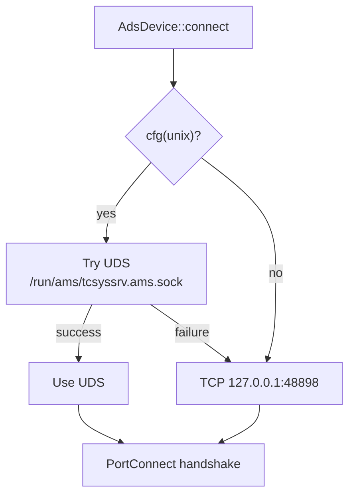

# Connecting over Unix Domain Sockets (UDS)

On **Beckhoff RT Linux** and **TwinCAT/BSD**, the local AMS router does not listen on
TCP `127.0.0.1:48898`. It exposes a **Unix domain socket** instead. Clients on the
same machine should talk to that socket; TCP loopback is not the local path on
those platforms.

Windows TwinCAT (XAE/XAR) still uses TCP on port 48898. UDS support in this crate
is compiled only on Unix targets (`cfg(unix)`).

## Default socket path

Beckhoff places the local AMS router socket at:

```text
/run/ams/tcsyssrv.ams.sock
```

That path is what `AdsDevice::connect` tries first on Unix. If the socket is
missing or the connect fails, it falls back to TCP `127.0.0.1:48898`.

If your image or install uses a different path, call `connect_uds` with that path
explicitly.

## How `AdsDevice::connect` chooses a transport



In both cases a successful local connect still performs a **PortConnect**
handshake. The router assigns a source AMS address the same way it does over TCP.

High-level helpers (`AdsRuntime::connect_local`, `AdsSystemService::connect_local`,
`AdsLicense::connect_local`, `AdsLogger::connect_local`, …) all go through
`AdsDevice::connect`, so they pick up UDS automatically on RT Linux / TwinCAT/BSD.

## Explicit UDS connect

Use `connect_uds` when you want to force the Unix socket (or a non-default path)
and skip the TCP fallback:

```rust,no_run
use std::time::Duration;
use tcads::client::devices::blocking::AdsDevice;

// Blocking (Unix only)
let device = AdsDevice::connect_uds("/run/ams/tcsyssrv.ams.sock", Duration::from_secs(5))?;
println!("Source: {}", device.source());
device.shutdown()?;
# Ok::<(), Box<dyn std::error::Error>>(())
```

```rust,no_run
use tcads::client::devices::tokio::AdsDevice;

// Async (Unix only)
#[tokio::main]
async fn main() -> Result<(), Box<dyn std::error::Error>> {
    let device = AdsDevice::connect_uds("/run/ams/tcsyssrv.ams.sock", None).await?;
    println!("Source: {}", device.source());
    device.shutdown().await;
    Ok(())
}
```

At the transport layer the same path is available as
`tcads_io::{blocking,tokio}::UnixAmsStream` (`AmsStream<UnixStream>`).

## Timeouts

| API                    | Connect timeout                                                                     | Command timeout after connect                           |
|------------------------|-------------------------------------------------------------------------------------|---------------------------------------------------------|
| Blocking `connect_uds` | **None** – `std::os::unix::net::UnixStream::connect` has no timeout                 | Yes – the `timeout` argument applies to ADS round-trips |
| Tokio `connect_uds`    | Yes – when `Some(duration)` is passed, connect is wrapped in `tokio::time::timeout` | Yes – same `timeout` applies to later ADS commands      |

If you need a bounded connect on the blocking path, either use the Tokio client or
drive a non-blocking `UnixStream` yourself and pass it into `AdsDevice::new`.

## Quick checklist

1. On RT Linux / TwinCAT/BSD, prefer `AdsDevice::connect` (auto UDS) or
   `connect_uds("/run/ams/tcsyssrv.ams.sock", ...)`.
2. Confirm the socket exists: `ls -l /run/ams/tcsyssrv.ams.sock`.
3. Do **not** use `connect_uds` when talking to a remote router; use
   `connect_remote` and a [static route](static-routes.md).
4. On Windows, ignore UDS; use TCP as usual.
